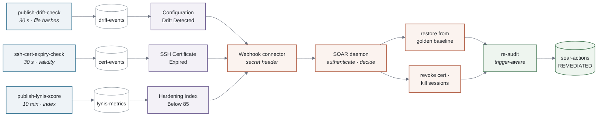
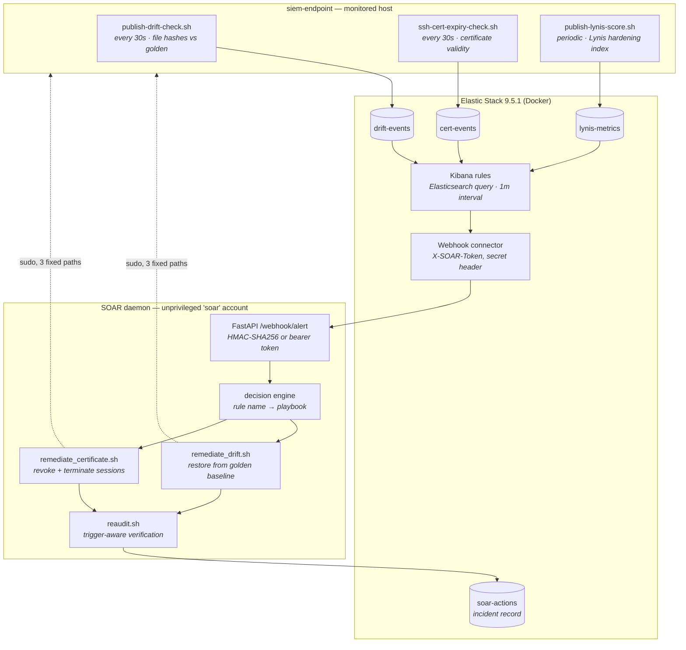

# Closed-Loop SOAR Remediation

Automated detection, remediation and verification of security configuration
drift and expired SSH certificates, built on a self-hosted Elastic stack and a
Python remediation daemon.

Phase 4 of a four-phase security engineering programme. Phases 1–3 built the
hardened host, the SSH certificate authority and the SIEM telemetry; this phase
closes the loop so that a detection produces a correction and a correction is
verified, without a human in the path.

---

## What it does





**Trigger A — configuration drift.** A security-relevant file stops matching
its approved baseline. The daemon restores it from the golden copy, preserves
the drifted version as evidence, validates the configuration before reloading
the service, and re-audits.

**Trigger B — expired certificate.** An SSH user certificate passes its
validity window. The daemon appends it to the OpenSSH revocation list, confirms
the `RevokedKeys` directive is actually in force, terminates any live sessions
belonging to its principal, and retires the certificate from the monitored
register.

---

## Measured response times

Each figure is the full path: attack introduced → detected → remediated →
verified on the host.

| Scenario | Runs | Best | Worst | Target |
|---|---|---|---|---|
| 1 — unapproved SSH configuration change | *see docs/benchmarks.md* | 38.28 s | 64.51 s | 60 s |
| 2 — use of an expired certificate | *see docs/benchmarks.md* | 72.60 s | 72.60 s | — |

The spread is not noise. Detection is bounded by two independent polling
cycles: a 30-second integrity check and Kibana's 60-second minimum rule
interval. Worst case is therefore roughly 90 seconds regardless of how fast the
remediation itself runs — the playbooks complete in **under 0.1 seconds**.

**The 60-second target in the brief is not reliably achievable with a polling
architecture.** Meeting it consistently requires event-driven detection —
`inotify` or an auditd watch on the configuration files, pushing to the daemon
directly — which removes both polling cycles from the path. That is a design
change, not a tuning exercise, and it is stated here rather than worked around.

---

## Security model

| Control | Why |
|---|---|
| Daemon runs as an unprivileged `soar` account | A webhook endpoint reachable from the network should not be root |
| `sudo` limited to three absolute script paths, no wildcards | A wildcard would let the daemon run anything matching the pattern |
| Only five named environment variables pass through `sudo` | Passing the whole environment would hand playbooks the webhook secrets |
| HMAC-SHA256 or bearer token, `hmac.compare_digest` | Constant-time comparison; a timing oracle on an auth check is still an auth bypass |
| `X-SOAR-Token` stored as a Kibana **secret** header | A config header sits in plaintext in the saved-objects index |
| Golden baselines are never written by the daemon | Otherwise an attacker alters a file, waits one cycle, and the drift becomes the new baseline |
| Configuration validated (`sshd -t`, `nginx -t`) before reload | Reloading a broken sshd config on a remote host is how people lose the machine they are fixing |
| Certificate playbook refuses to act without an explicit Key ID | "Revoke whatever looks wrong" is a denial-of-service primitive |
| Monitored register lives in `/etc/ssh/monitored-certs`, not home directories | A user can write a certificate into their own `~/.ssh` |

---

## Failure modes found during development

These are documented because each one presented as success.

**1. systemd sandbox silently blocked every remediation.** The unit used
`ProtectSystem=strict` with `ReadWritePaths=/var/log`. That makes the entire
filesystem read-only *inside the unit's mount namespace* and `sudo` does not
escape a mount namespace. The playbook ran as root, into a read-only `/etc`,
and `cp` failed. Detection, alerting and webhook delivery all reported success
for three consecutive test runs while nothing was ever repaired.

**2. The playbook exited 0 after failing.** Its early-exit checked only whether
any file had *changed*, not whether any restore had *failed*, so a run with one
failure and no successes returned "no changes required" and exit code 0. The
daemon recorded the incident as handled. Combined with (1), the pipeline
reported green while doing nothing at all.

**3. `sudo` stripped the alert context.** `env_reset` is the default, so
`SOAR_CERTIFICATE_ID` never reached the certificate playbook. The playbook
correctly refuses to guess which certificate to revoke, so it would have exited
1 on every real alert. The symptom in the drift logs  `rule=unset host=unset`
 had been visible for weeks and looked cosmetic.

**4. Verification was scoped to the wrong signal.** A successful drift
remediation was recorded as `FAILED` because the Lynis hardening index of the
host was below baseline for unrelated reasons. Verification is now
trigger-aware: a drift alert is verified against the golden baseline, a
hardening-index alert against the index.

**5. Alert suppression makes repeat attacks invisible.** A Kibana alert stays
Active while any matching document sits in its time window, and the action
fires on status change. A second attack inside that window produces no second
webhook. This is correct de-duplication behaviour and a real gap in coverage:
an attacker who knows the window can act inside it.

---

## Remediation playbooks

Remediation is implemented as Ansible playbooks, invoked through thin wrappers
that sudoers grants by absolute path. `ansible-playbook` itself is never
granted: it takes a playbook path as an argument, so granting it would grant
arbitrary code execution as root.

Ansible buys three things the shell implementation could not provide:

**Real rollback.** If a restored file fails validation, `block`/`rescue` puts
the previous file back and fails loudly. The shell version validated after
writing and had no way back.

**Rollback scoped correctly.** A rollback is right when the *restored file*
fails validation ,the baseline itself is bad. It is wrong when only the
*service reload* fails: the on-disk configuration is correct and validated, and
reverting it would put the weakened file back. The reload therefore sits
outside the rescue block. A failed reload is reported, never undone.

**Alert context as parameters, not environment.** Values arrive as
`--extra-vars`. The shell version passed them as environment variables, which
`sudo`'s `env_reset` silently stripped — a fault that went unnoticed for weeks
and would have disabled certificate revocation entirely. That class of failure
cannot occur here.

Playbook behaviour verified across five runs: drift corrected, clean run
idempotent, failed reload leaves the hardened file in place, bad baseline rolls
back, certificate revocation idempotent on repeat.

## Repository layout

```
daemon/              FastAPI remediation daemon
ansible/             Remediation playbooks (drift, certificate, re-audit)
playbooks/           Thin wrappers that sudoers grants by absolute path
playbooks/legacy-shell/   The original shell implementation, kept for reference
publishers/          Telemetry: integrity check, certificate expiry, Lynis index
systemd/             Service and timer units
kibana/              Connector and rule manifests, with the gotchas annotated
sudoers/             Scoped privilege grant
tests/               Authentication tests, attack emulation, benchmark runner
install/             Deployment scripts
docs/                Architecture, benchmarks, findings, diagrams
```

## Installation

```bash
sudo ./install/install.sh                      # daemon, Ansible playbooks, sudoers, service
sudo ./install/install-ca.sh tonnie admin-2026 # SSH CA and certificate register
sudo ./install/install-publishers.sh           # telemetry publishers and timers
```

Already running the shell implementation? `sudo ./install/migrate-to-ansible.sh`
swaps it for the Ansible one in place, leaving the daemon, the sudoers grant and
the service unit untouched.

Then set `ES_PASSWORD` in `/etc/soar/soar.env`, restart the daemon, and create
the Kibana connector and rules from `kibana/`.

Verify:

```bash
curl -s http://127.0.0.1:8088/health
sudo ./tests/test_webhook.sh          # authentication and decision engine
sudo ./tests/scenario1_ssh_drift.sh   # drift attack emulation
sudo ./tests/scenario2_cert_expiry.sh # expired certificate emulation
```

## Known limitations

- The SIEM runs on the host it monitors. An attacker with root could tamper
  with the evidence. A production deployment separates them.
- The SSH CA private key is kept on the monitored host. It belongs on an
  offline management host the fleet cannot reach.
- Certificate revocation is exercised; TLS certificate revocation is not.
- The host's Lynis hardening index is below the 85 baseline, so Trigger A's
  compliance path cannot presently verify as remediated. Trigger A's fast path
  and Trigger B both verify correctly.
