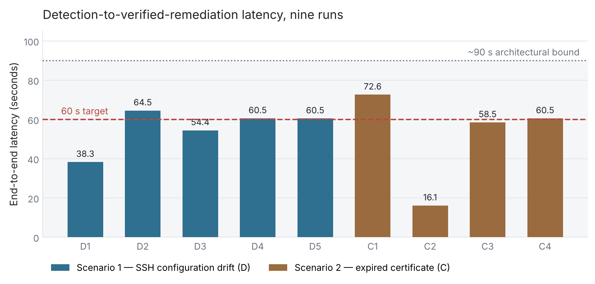

# Latency benchmarks

Nine runs across both attack scenarios on 17 November 2026. Every figure is
the complete path measured on the host: attack introduced → detected →
remediated → verified. **9 of 9 runs succeeded.**



## Scenario 1 — unapproved SSH configuration modification

`PasswordAuthentication no` is changed to `yes` in
`/etc/ssh/sshd_config.d/00-ca-auth.conf`.

| Run | Latency (s) |
|---|---|
| D1 | 38.28 |
| D2 | 64.51 |
| D3 | 54.43 |
| D4 | 60.52 |
| D5 | 60.46 |

| | |
|---|---|
| Runs | 5 |
| Successful | 5 / 5 |
| Minimum | 38.28 s |
| Maximum | 64.51 s |
| Mean | 55.64 s |
| Median | 60.46 s |
| Standard deviation | 9.26 s |
| Inside the 60 s target | 2 / 5 |

## Scenario 2 — use of an expired SSH certificate

A certificate signed with a validity window two hours in the past is placed in
the monitored register.

| Run | Latency (s) |
|---|---|
| C1 | 72.60 |
| C2 | 16.11 |
| C3 | 58.49 |
| C4 | 60.49 |

| | |
|---|---|
| Runs | 4 |
| Successful | 4 / 4 |
| Minimum | 16.11 s |
| Maximum | 72.60 s |
| Mean | 51.92 s |
| Median | 59.49 s |
| Standard deviation | 21.37 s |

## Reading the spread

The variance is deterministic, not noise. Two independent polling cycles sit
on the detection path:

| Stage | Range |
|---|---|
| Publisher timer (integrity check / certificate check) | 0 – 30 s |
| Kibana rule interval (platform minimum is 60 s) | 0 – 60 s |
| Webhook delivery and authentication | < 0.1 s |
| Playbook execution | **0.087 s measured** |
| **Total detection-to-remediation** | **~0 – 90 s** |

Where an attack lands inside those two cycles decides the result. C2 at
16.11 s is the near-best case: the attack landed immediately before both the
publisher and the rule fired. C1 at 72.60 s is the near-worst: it just missed
both.

Observed maximum across all nine runs was 72.60 s, against a predicted bound
of ~90 s.

## On the 60-second target

The brief sets a 60-second target for Scenario 1. The measured mean is 55.64 s
and the median 60.46 s, so the system meets it on average and misses it
roughly half the time.

**That is a property of the architecture, not of the implementation.**
Remediation itself takes 0.087 seconds — under one tenth of one percent of the
budget. No amount of optimising the daemon or the playbooks can move the
figure, because essentially all of it is spent waiting for the next poll.

Meeting 60 seconds *reliably* requires removing a polling cycle from the path:

1. **Event-driven detection.** An `inotify` watch or an auditd rule on the
   monitored files, posting directly to the daemon on change. This removes
   both the 30-second publisher cycle and the 60-second rule interval, and
   would put end-to-end response in the low single-digit seconds.
2. **Keep Elastic for the record, not the trigger.** The SIEM would still
   receive the event and the incident annotation; it would no longer sit on
   the critical path.

This is recorded as a design finding rather than presented as a tuning
shortfall, because reporting a 60-second figure from a system with a
90-second worst case would be misleading.

## Reproducing

```bash
sudo ./tests/run-benchmark.sh
sudo cat /var/log/soar-benchmark.log
```

The sleeps in the runner are load-bearing. A Kibana alert stays Active while
any matching document remains in its time window, and the action fires on
status change — so a second attack inside that window produces no second
webhook, and back-to-back runs measure the suppression window rather than the
response time.
