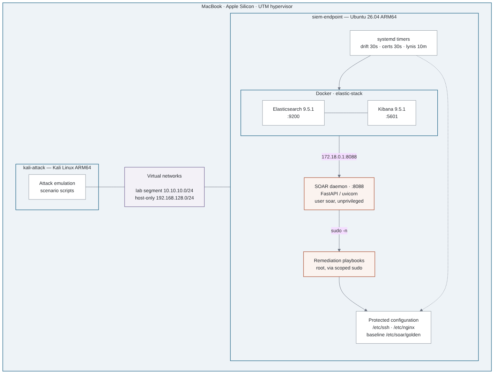
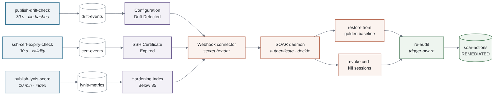
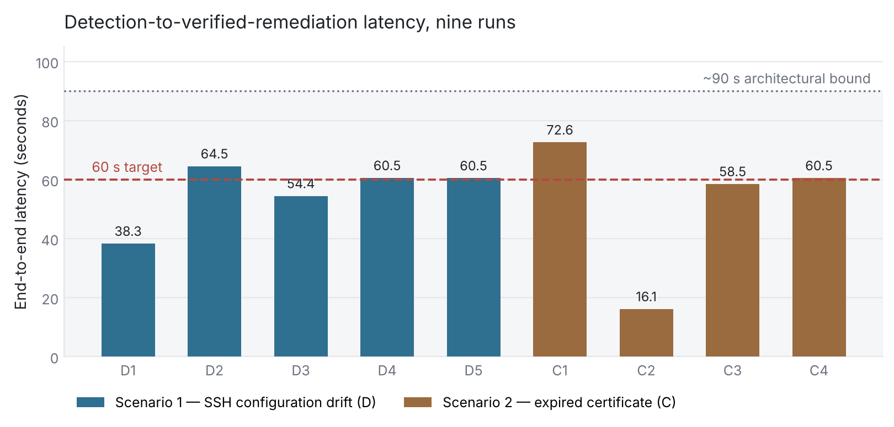

# Phase 4 — Automated SOAR and Closed-Loop Remediation

**Implementation Report**

Tonnie Udoekpo · Principal SIEM & SOAR Security Engineer · 18 November 2026

## Executive summary

This report documents the delivery of Phase 4: an automated Security Orchestration, Automation and Response pipeline connected to the Elastic SIEM, closing the gap between detecting a security regression and neutralising it.

A Kibana webhook action connector routes high-severity alerts to an asynchronous Python/FastAPI daemon. The daemon authenticates the call, selects a remediation playbook from the alert, executes it through Ansible under tightly scoped privilege, re-audits the host, and annotates the incident in Elastic. No human is in the path.

Two attack scenarios were executed across nine runs. All nine produced a correct automated response, with end-to-end times from 16.11 to 72.60 seconds.

> **The most instructive result is a failure, not a success**
>
> For three consecutive runs the pipeline reported complete success while repairing nothing. The alert fired, the webhook was delivered, the daemon returned HTTP 200 and recorded the incident as handled — and the file it was meant to repair was never touched. Three independent faults combined to produce a convincing green result over an inert system. All three are documented in Section 6, because an automated control that cannot fail visibly is more dangerous than no automation at all.

## 1. Environment and deviations from the brief

| **Item**          | **As specified**                | **As delivered**                                                                                                                                                                                |
|-------------------|---------------------------------|-------------------------------------------------------------------------------------------------------------------------------------------------------------------------------------------------|
| **SIEM**          | Elastic Cloud                   | Self-managed Elasticsearch and Kibana 9.5.1 under Docker Compose. The hosted trial expired mid-programme; a self-managed stack also permits the Platinum trial that webhook connectors require. |
| **Host**          | Local Linux workstation         | siem-endpoint — Ubuntu 26.04.1 LTS ARM64 under UTM                                                                                                                                              |
| **Daemon**        | Python 3 (FastAPI/Flask)        | Python 3 / FastAPI under uvicorn, systemd-managed, unprivileged service account                                                                                                                 |
| **Remediation**   | Ansible playbook or Bash script | Ansible playbooks, invoked through wrappers. The original Bash implementation is retained in the repository.                                                                                    |
| **Drift trigger** | lynis.hardening_index \< 85     | Implemented, plus a faster configuration-integrity rule. Rationale in Section 2.2.                                                                                                              |



*Figure 1 — Laboratory topology: hypervisor, virtual machines, network segments and the privilege boundary.*

*Figure 1 — Laboratory topology: hypervisor, virtual machines, network segments and the privilege boundary.*

## 2. Objective 1 — Kibana webhook action connectors and alert rules

### 2.1 Pipeline

Telemetry publishers write state into Elasticsearch; Kibana rules evaluate that state; a webhook connector delivers matching alerts to the daemon; the daemon selects and runs a playbook; the daemon re-audits and writes an incident record back.



*Figure 2 — Detection and response pipeline, from telemetry publisher to verified incident record.*

*Figure 2 — Detection and response pipeline, from telemetry publisher to verified incident record.*

### 2.2 Why there are two drift triggers

> **A Lynis audit cannot sit on a 60-second response path**
>
> The brief names lynis.hardening_index &lt; 85 as the drift trigger and sets a 60-second response target for Scenario 1. A Lynis audit takes 60 to 90 seconds to complete, so the measurement alone exceeds the entire budget. The design therefore separates the two concerns: a content comparison of the protected configuration files against the approved baseline performs detection in well under a second, and the Lynis index remains the slower compliance measure. Both are implemented, both raise rules, and both reach the same daemon.

### 2.3 Telemetry publishers

| **Publisher**                | **Interval** | **Index and role**                                                                        |
|------------------------------|--------------|-------------------------------------------------------------------------------------------|
| **publish-drift-check.sh**   | 30 s         | drift-events — compares live configuration against the golden baseline by content         |
| **ssh-cert-expiry-check.sh** | 30 s         | cert-events — publishes OK / EXPIRING / EXPIRED per certificate with Key ID and principal |
| **publish-lynis-score.sh**   | 10 min       | lynis-metrics — the hardening index. Demonstration interval; daily in production          |

### 2.4 Connector manifest

The connector is created through the Kibana actions API. Three configuration details carry real weight and are recorded here because each one is a trap.

```
POST kbn:/api/actions/connector
{
"name": "SOAR Remediator Webhook",
"connector_type_id": ".webhook",
"config": {
"method": "post",
"url": "http://172.18.0.1:8088/webhook/alert",
"hasAuth": false,
"headers": { "Content-Type": "application/json" }
},
"secrets": {
"secretHeaders": { "X-SOAR-Token": "&lt;redacted&gt;" }
}
}
```

### Addressing

Kibana runs in a container, so localhost inside Kibana is the container, not the host where the daemon listens. The connector targets 172.18.0.1 — the host's address on the Docker bridge — and the daemon binds to all interfaces rather than loopback.

### Credential storage

X-SOAR-Token is created as a secret header, not a config header. A config header is stored in plaintext in the Kibana saved-objects index and is readable by anyone with access to it; a secret header is encrypted with the stack's encrypted-saved-objects key.

### Rule naming

The daemon selects a playbook by matching the alert rule name. This makes the name load-bearing: renaming a rule without updating the matcher silently disables remediation, because the webhook still arrives and the daemon still answers 200 having done nothing. The constraint is documented alongside the rule manifests in the repository.

### 2.5 Alert rules

| **Rule**                                      | **Index**     | **Condition**                                                                     |
|-----------------------------------------------|---------------|-----------------------------------------------------------------------------------|
| **Configuration Drift Detected**              | drift-events  | drift.status = DRIFTED — a protected file no longer matches the approved baseline |
| **Lynis Hardening Index Below Baseline (85)** | lynis-metrics | lynis.hardening_index \< 85                                                       |
| **SSH Certificate Expired**                   | cert-events   | ssh_cert.status = EXPIRED                                                         |

All three are Elasticsearch-query rules using Query DSL, evaluated every minute — the platform minimum.

### 2.6 Payload structure

The payload carries the event context named in the brief:

```
{
"target_host": "{{context.hits.0._source.host.name}}",
"alert_rule": "{{rule.name}}",
"severity": "high",
"hardening_score": {{context.hits.0._source.lynis.hardening_index}},
"timestamp": "{{date}}"
}
```

The certificate rule adds two fields the specified payload does not carry. The remediation playbook refuses to guess which certificate to revoke, so the Key ID and principal are lifted out of the matching document:

```
"certificate_id": "{{#context.hits}}{{_source.ssh_cert.key_id}}{{/context.hits}}",
"principal": "{{#context.hits}}{{_source.ssh_cert.principal}}{{/context.hits}}"
```

> **Document size must be set to 1**
>
> The expiry publisher runs every 30 seconds, so a two-minute rule window holds four matching documents. A Mustache section iterating over all of them emits the Key ID four times, concatenated — an identifier matching no certificate at all. The rule's size parameter must be 1.

## 3. Objective 2 — Python/FastAPI SOAR response daemon

soar_remediator.py is an asynchronous FastAPI service exposing a health endpoint and the alert webhook. It runs under an unprivileged soar account and reaches root only through sudo, restricted to three absolute script paths with no wildcards.

### 3.1 Payload validation and authentication

Two schemes are accepted, as the brief permits either: a secret token in an X-SOAR-Token header, or an HMAC-SHA256 signature of the raw request body in X-SOAR-Signature.

```
expected = hmac.new(SOAR_HMAC_SECRET, raw_body, hashlib.sha256).hexdigest()
if hmac.compare_digest(signature.lower(), expected):
return "hmac"
raise HTTPException(status_code=401, detail="invalid credentials")
```

Both comparisons use constant-time comparison. A naive string comparison leaks, through how long it takes to fail, how much of a candidate token is correct — enough to recover a secret byte by byte. A timing oracle on an authentication check is still an authentication bypass.

### Authentication tests

| **Test**                                   | **Expected** | **Result** |
|--------------------------------------------|--------------|------------|
| **Request with no credentials**            | 401          | Pass       |
| **Request with an incorrect token**        | 401          | Pass       |
| **Request with a valid HMAC signature**    | 200          | Pass       |
| **Request with a tampered HMAC signature** | 401          | Pass       |

### 3.2 Automated decision engine

The daemon maps the alert rule name to a remediation playbook. An alert matching no playbook is logged and acknowledged without action, rather than falling through to a default — an automated control that guesses is one bad alert away from damaging the host it protects.

```
def select_playbook(alert):
rule = (alert.alert_rule or "").lower()
if "hardening index" in rule or "drift" in rule:
return "remediate_drift.sh"
if "certificate" in rule and ("expir" in rule or "revok" in rule):
return "remediate_certificate.sh"
return None
```

Playbook execution is serialised behind a lock. Two alerts arriving together must not run two restores against the same files, and the Lynis re-audit writes to a single report file that cannot be shared between concurrent runs.

### 3.3 Trigger A — hardening index drift

Restores the hardened configuration from the approved golden baseline:

- Compares each protected file against its golden copy — /etc/ssh/sshd_config, the hardened SSH drop-in, /etc/nginx/nginx.conf and the TLS site.

- Preserves the drifted file as evidence before overwriting it.

- Restores the approved version.

- Validates with sshd -t and nginx -t, then reloads the services.

- Reports a count of files restored and a count of failures.

> **The daemon never writes to the golden baseline**
>
> Baselines are established once, by hand. If remediation could update its own source of truth, an attacker would alter a protected file, wait one cycle, and have the drift adopted as the approved state.

### 3.4 Trigger B — expired SSH certificate

- Locates the certificate in the monitored register by Key ID read from the certificate itself, never by filename.

- Appends it to /etc/ssh/revoked_keys.

- Confirms the RevokedKeys directive is in force, rather than assuming an untouched file is being read.

- Validates and reloads sshd.

- Terminates live sessions belonging to the principal.

- Retires the certificate from the monitored register so the alert can recover.

> **Terminating the session is a separate step, not a redundant one**
>
> Revoking a certificate stops future authentication. It does nothing to a session already established, because that session holds an open channel and sshd does not re-check the credential. Without the termination step, an attacker who authenticated before revocation simply stays connected.

### 3.5 Ansible remediation playbooks

Remediation is implemented as Ansible playbooks, invoked through thin wrappers that sudoers grants by absolute path. ansible-playbook itself is never granted: it takes a playbook path as an argument, so granting it would grant arbitrary code execution as root. The privilege boundary is therefore identical to the Bash implementation it replaced.

Three properties follow that the Bash version could not provide:

- Real rollback. If a restored file fails validation, block/rescue puts the previous file back and fails loudly. The Bash version validated after writing and had no way back.

- Rollback scoped to the right failure. A rollback is correct when the restored file fails validation, because the baseline itself is bad. It is wrong when only the service reload fails: the configuration on disk is correct and validated, and reverting it would put the weakened file back. The reload therefore sits outside the rollback block, and a failed reload is reported rather than undone.

- Alert context arrives as --extra-vars rather than environment variables, which eliminates the sudo env_reset fault described in Section 6.3 as a class rather than as an instance.

Playbook behaviour was verified across five runs covering every path: drift corrected and the hardened file reinstated; a clean run reporting no change; a failed reload leaving the hardened file in place; a deliberately corrupt baseline rolled back and reported; and certificate revocation proving idempotent when repeated.

## 4. Objective 3 — Re-audit and post-remediation verification

Remediation that is not verified is a hope. After every playbook run the daemon triggers a secondary Lynis scan and an OpenSSH validation check, then writes an incident record to the soar-actions index carrying the status, the criterion used to judge it, the playbook output, the hardening index afterwards and the total elapsed time.

### 4.1 Trigger-aware verification

The first implementation held every remediation to the Lynis index. A successful drift repair was therefore recorded as FAILED because the host's overall index was below baseline for unrelated reasons. Verification now matches the alert that fired:

| **Alert**                          | **Criterion**                                | **Why**                                                            |
|------------------------------------|----------------------------------------------|--------------------------------------------------------------------|
| **Configuration drift**            | Every deviating file restored, zero failures | The alert fired on file content; the index measures the whole host |
| **Hardening index below baseline** | Lynis index returns to 85 or above           | The index is the condition that fired                              |
| **Certificate expired**            | Revocation completed and validated           | Revocation is binary; there is no score to recover                 |

The incident record carries verification_criterion alongside the status, so a reviewer can see which test was applied rather than inferring it.

### 4.2 Incident annotation in Elastic

A verified remediation is annotated REMEDIATED in the soar-actions index:

```
"soar": {
"status": "REMEDIATED",
"verification_criterion": "configuration_matches_baseline",
"playbook": "remediate_drift.sh",
"auth_scheme": "token",
"alert_rule": "Configuration Drift Detected",
"target_host": "siem-endpoint",
"score_after_remediation": 68,
"baseline": 85,
"remediation": { "ok": true, "duration_seconds": 0.087 },
"end_to_end_seconds": 44.07
}
```

Note the brief's requirement that the post-remediation Lynis score returns to 85 or above. On the current host it does not: the index reads 68 because the laboratory was rebuilt after hardware loss and the Phase 1 hardening has not been re-applied to the replacement. The drift and certificate paths verify correctly. The hardening-index path cannot reach a passing verification until the host is re-hardened, and this is recorded as an outstanding item in Section 8 rather than concealed.

## 5. Objective 4 — Attack emulation and latency benchmark

### 5.1 Scenario 1 — unapproved SSH configuration modification

PasswordAuthentication is changed from no to yes in the hardened SSH drop-in. The test script records the moment of change, polls the file every two seconds, times the restoration, verifies the configuration is valid afterwards, and reverts the change itself if the system fails to respond — so a failed test never leaves the host weakened.

### 5.2 Scenario 2 — expired certificate usage

The scenario has two halves, matching the brief's requirement that the session be both blocked and logged.

### Revocation

A certificate is signed with a validity window two hours in the past and placed in the monitored register. The throwaway signing key is destroyed immediately after use, since the certificate is the artefact under test and a retained key would be a credential lying around for no reason. The test times the interval until the pipeline revokes the certificate and retires it from the register.

### Blocked authentication

A second test mints an expired certificate for a real principal and attempts an SSH session with it. The underlying key is not present in any authorized_keys file, so there is no path by which the attempt could succeed on another credential and no ambiguity in the result.

```
Certificate under test:
Key ID: "expired-auth-233642"
Valid: from 2026-11-17T21:36:42 to 2026-11-17T22:36:42
Attempting SSH authentication with the expired certificate...
tonnie@127.0.0.1: Permission denied (publickey).
RESULT: authentication REFUSED (exit 255) - expected
```

The authentication log records the refusal and states the reason explicitly:

```
sshd-session[945535]: error: Refusing certificate ID "expired-auth-233642"
serial=0 signed by ED25519 CA SHA256:Ts8IjAOlz/GceUIevn0g5ozpdIsvOT7R1K0MFzbLObY:
Certificate invalid: expired
sshd-session[945535]: Failed publickey for tonnie from 127.0.0.1 port 34952 ssh2:
ED25519-CERT SHA256:GhTmP8+fokw68ryys11mX6mGWJd0TbHjQPNgOdfn5Tc
ID expired-auth-233642 (serial 0) CA ED25519 SHA256:Ts8IjAOlz/...
sshd[182270]: srclimit_penalise: ipv4: new 127.0.0.1/32 deferred penalty
of 5 seconds for penalty: failed authentication
```

Three things are evidenced by that output. The certificate authority is trusted, since sshd validated the signature before rejecting the certificate on its expiry rather than failing to recognise it. The expiry is enforced by the server rather than by the client. And the rejection is attributable: the log names the Key ID, the principal, the source address and the signing CA, which is what makes the event usable for detection rather than merely a failed login.

### 5.3 Results



*Figure 3 — Detection-to-verified-remediation latency across nine runs.*

*Figure 3 — Detection-to-verified-remediation latency across nine runs.*

| **Scenario**                | **Runs** | **Min** | **Max** | **Mean** | **Median** |
|-----------------------------|----------|---------|---------|----------|------------|
| **1 — configuration drift** | 5        | 38.28 s | 64.51 s | 55.64 s  | 60.46 s    |
| **2 — expired certificate** | 4        | 16.11 s | 72.60 s | 51.92 s  | 59.49 s    |
| **All runs**                | 9        | 16.11 s | 72.60 s | 53.99 s  | 60.46 s    |

**All nine runs produced a correct automated response. Two of the five drift runs completed inside the 60-second target.**

### 5.4 Reading the spread

The variation is deterministic, not noise. Two independent polling cycles sit on the detection path, and where an attack lands within them decides the result.

| **Stage**                               | **Range**        | **Note**                             |
|-----------------------------------------|------------------|--------------------------------------|
| **Publisher timer**                     | 0 – 30 s         | Integrity or certificate check cycle |
| **Kibana rule interval**                | 0 – 60 s         | 60 seconds is the platform minimum   |
| **Webhook delivery and authentication** | \< 0.1 s         | Negligible                           |
| **Playbook execution**                  | 0.087 s measured | Negligible                           |
| **Total**                               | ~0 – 90 s        | Observed maximum 72.60 s             |

> **On the 60-second target**
>
> Remediation takes 0.087 seconds — under one tenth of one percent of the budget. Essentially the whole figure is spent waiting for the next poll, so no amount of optimising the daemon or the playbooks can improve it. Meeting 60 seconds reliably requires removing a polling cycle: an inotify watch or an auditd rule on the protected files, posting directly to the daemon on change, which would put end-to-end response into the low single-digit seconds and leave Elastic holding the record rather than sitting on the critical path. This is reported as a design finding rather than a tuning shortfall, because quoting a 60-second figure from a system with a 90-second worst case would be misleading.

### 5.5 A coverage gap found during benchmarking

Three benchmark runs launched twenty seconds apart all reported failure. A Kibana alert remains Active while any matching document sits inside its time window, and the action fires on status change — so a second attack inside that window produces no second webhook.

This is correct de-duplication behaviour and also a genuine gap: an attacker who understands the window can act inside it and receive no automated response. It is recorded rather than worked around.

## 6. Faults found during development

Each of the following presented as success. They are the most instructive part of the phase.

### 6.1 The systemd sandbox blocked every repair

The daemon's unit used ProtectSystem=strict with ReadWritePaths=/var/log. That makes the entire filesystem read-only inside the unit's own mount namespace — and sudo does not escape a mount namespace. The playbook ran as root, into a read-only /etc, and the copy failed. Detection, alerting and webhook delivery all reported success for three consecutive runs while nothing was repaired.

### 6.2 A failed playbook exited with a success code

The playbook's early exit tested whether any file had changed, but not whether any restore had failed. A run with one failure and no successes printed "no changes required" and exited zero, so the daemon recorded the incident as handled. Combined with 6.1, the pipeline reported green while entirely inert.

### 6.3 sudo stripped the alert context

sudo clears the environment by default. The daemon exported the alert details correctly and sudo removed them before the playbook could read them. For the drift playbook the cost was a log line reading rule=unset host=unset, which had been visible for weeks and looked cosmetic. For the certificate playbook it would have been fatal: that playbook refuses to guess which certificate to revoke, so with no identifier it would have failed on every genuine alert. The fix allows five named variables through and no more — passing the whole environment would hand every playbook the webhook secrets the daemon holds.

### 6.4 Verification was scoped to the wrong signal

A successful drift remediation was recorded as FAILED because the host's overall Lynis index was below baseline for unrelated reasons. Addressed in Section 4.1.

### 6.5 A revoked certificate never stopped alerting

A revoked certificate left in the monitored register continues to report as expired, so the alert never recovers and the pipeline cannot distinguish a new incident from the one just handled. Revoked certificates are now retired from the register as part of remediation.

> **What these have in common**
>
> Four of the five produced no error anybody would notice, and three made the system report success. The lesson carried out of this phase is that an automated control must be tested by confirming the end state on the host, never by trusting the pipeline's own account of itself.

## 7. Security model

| **Control**                                            | **Reasoning**                                                                              |
|--------------------------------------------------------|--------------------------------------------------------------------------------------------|
| **Daemon runs unprivileged**                           | A webhook endpoint reachable from the network should not be root                           |
| **sudo limited to three absolute paths, no wildcards** | A wildcard would let the daemon run anything matching the pattern                          |
| **ansible-playbook never granted directly**            | It takes a playbook path as an argument — granting it grants arbitrary root code execution |
| **Five named environment variables pass through sudo** | Passing the environment wholesale would expose the webhook secrets                         |
| **Constant-time credential comparison**                | A timing oracle on an authentication check is still an authentication bypass               |
| **Token held as a Kibana secret header**               | A config header is stored in plaintext in the saved-objects index                          |
| **Golden baselines never written by the daemon**       | Otherwise drift becomes the approved state after one cycle                                 |
| **Configuration validated before any service reload**  | Reloading a broken sshd config on a remote host loses access to the machine being fixed    |
| **Certificate playbook requires an explicit Key ID**   | Revoking whatever looks wrong is a denial-of-service primitive                             |
| **Monitored register outside home directories**        | A user can write a certificate into their own ~/.ssh                                       |

## 8. Limitations and recommendations

### 8.1 Limitations

- The SIEM runs on the host it monitors. An attacker with root could tamper with the evidence.

- The SSH CA private key is held on the monitored host rather than on an offline management system.

- The host's Lynis hardening index is 68 against a baseline of 85, because the rebuilt laboratory has not had the Phase 1 hardening re-applied.

- Alert suppression leaves a window inside which a repeat attack receives no automated response.

- The TLS certificate in use is self-signed, and TLS certificate revocation has not been exercised.

### 8.2 Recommendations

|       | **Recommendation**                                        | **Rationale**                                                                        |
|-------|-----------------------------------------------------------|--------------------------------------------------------------------------------------|
| **1** | Re-apply the Phase 1 hardening to the rebuilt host        | Restores the 85 baseline and makes the hardening-index trigger verifiable end to end |
| **2** | Move detection from polling to an inotify or auditd watch | The only change that can bring response reliably inside 60 seconds                   |
| **3** | Move the SIEM off the monitored host                      | Removes the ability of a compromised host to alter its own evidence                  |
| **4** | Move the CA private key to an offline management host     | Compromise of a target should not confer the ability to mint credentials             |
| **5** | Address the alert suppression window                      | A repeat attack inside the window currently receives no response                     |
| **6** | Rotate the webhook token                                  | It was exposed during development and should be regenerated                          |

## 9. Deliverables index

Where each item required by the brief is located.

| **Required item**                      | **Location**                                                                     |
|----------------------------------------|----------------------------------------------------------------------------------|
| **Architecture topology diagrams**     | Figures 1 and 2 of this report; sources in docs/                                 |
| **Kibana webhook connector manifests** | Section 2.4; kibana/connector-soar-webhook.json                                  |
| **Python SOAR daemon source code**     | Section 3; daemon/soar_remediator.py                                             |
| **Ansible remediation playbooks**      | Section 3.5; ansible/remediate_drift.yml, remediate_certificate.yml, reaudit.yml |
| **Latency benchmarks**                 | Section 5; docs/benchmarks.md                                                    |
| **systemd service files**              | systemd/ — daemon unit plus three publisher timers                               |
| **Kibana rule exports**                | kibana/ — three rule manifests, annotated                                        |
| **Automated test scripts**             | tests/ — authentication tests, both attack scenarios, benchmark runner           |

**The closed loop works end to end on both scenarios. All nine test runs succeeded, and every fault found during development is documented above rather than quietly corrected.**
